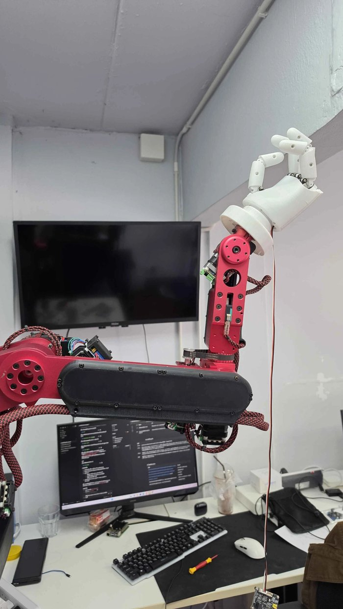
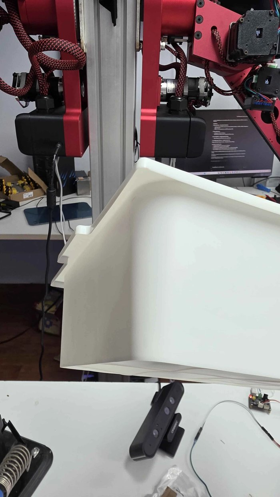
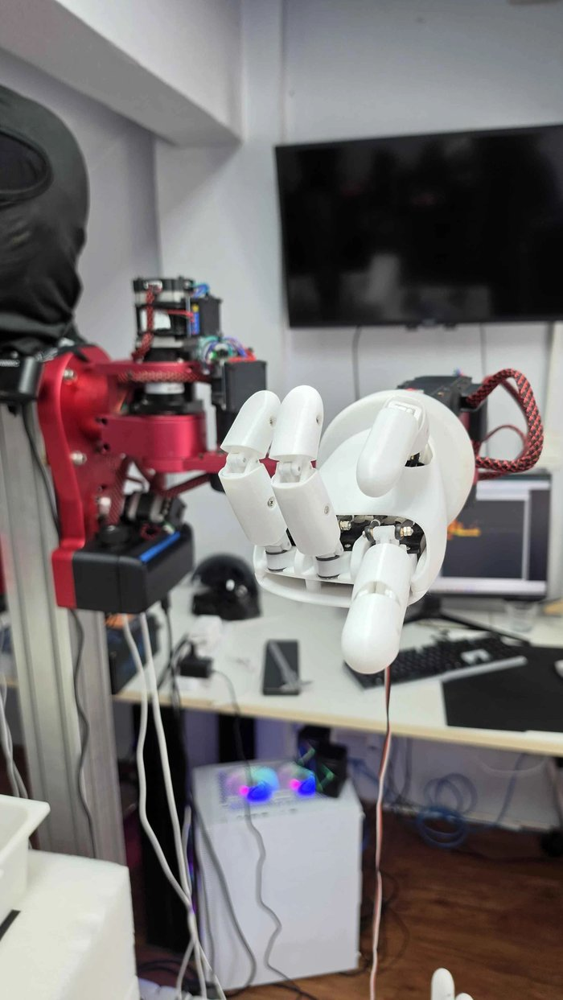
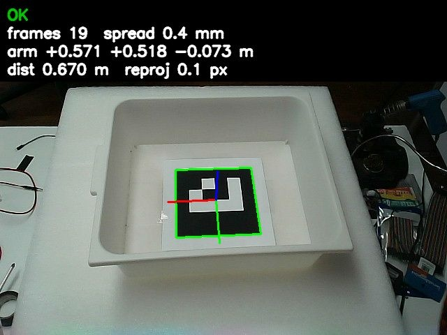
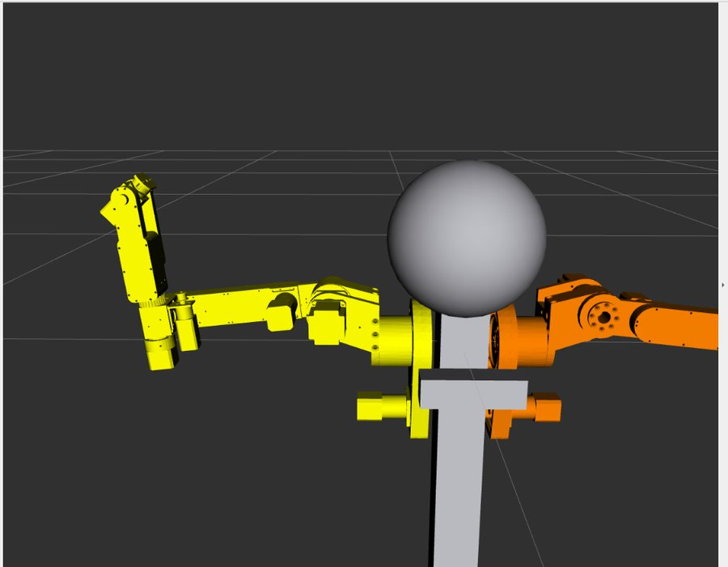
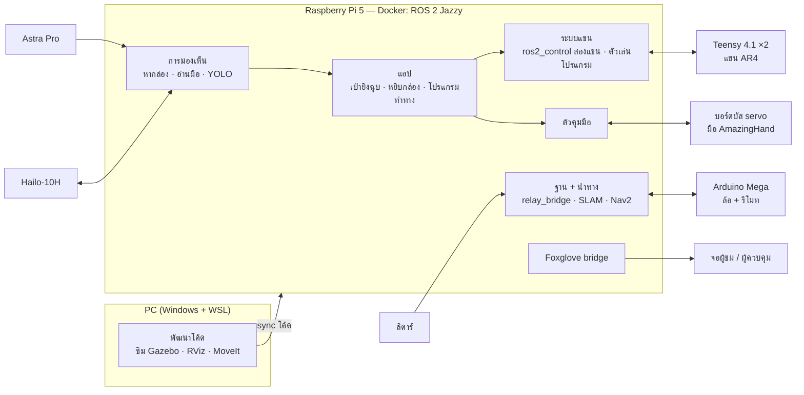

# Humanoi

### หุ่นยนต์สองแขนบนฐานล้อ mecanum — มองเห็น หยิบจับ เล่นกับคนได้ · ROS 2 Jazzy บน Raspberry Pi 5

<p align="center">
  
  
  
</p>

Humanoi คือหุ่นยนต์สาธิตสำหรับงานนิทรรศการและลูกค้า ออกแบบให้เห็นว่าหุ่นที่ **มีสองแขน มีมือห้านิ้ว มีตา
และเคลื่อนที่ได้** ทำงานร่วมกันเป็นระบบเดียวได้อย่างไร — แขนกลอุตสาหกรรมขนาดเล็กสองตัวติดบนเสากลาง
ปลายแขนเป็นมือหุ่นยนต์ห้านิ้ว กล้อง depth ใต้คางเป็นตา ลิดาร์ช่วยรู้รอบตัว ทั้งหมดตั้งอยู่บนฐานล้อ mecanum
ที่เคลื่อนที่ได้ทุกทิศทาง และควบคุมด้วย ROS 2 บนคอมพิวเตอร์บอร์ดเดียว

ทั้งโปรเจกต์ประกอบจากชิ้นส่วนที่หาได้และซอฟต์แวร์ open source (แขน AR4, มือ AmazingHand, ROS 2, MoveIt)
แล้วเขียนส่วนที่ทำให้มันใช้งานได้จริงเพิ่มเอง — ตั้งแต่เฟิร์มแวร์บอร์ดคุมแขน ไปจนถึงแอปที่หุ่นเล่นกับคน

---

## หุ่นทำอะไรได้แล้ว

### ✊✋✌️ เป่ายิงฉุบกับคน
หุ่นยกแขนนับจังหวะ "เป่า-ยิ้ง-ฉุบ" มือออกท่าที่สุ่มไว้ กล้องอ่านมือผู้เล่นด้วย MediaPipe แล้วตัดสินผล —
ชนะก็ชูนิ้วโป้ง แพ้ก็ส่ายนิ้ว · หน้าจอ HUD ใน Foxglove นับถอยหลัง 3-2-1 พร้อมจังหวะแขน
ให้คนรอบๆ ดูเข้าใจว่าหุ่นกำลังทำอะไร · รายละเอียด: [`docs/RPS_GAME.md`](docs/RPS_GAME.md)

### 👋 ท่าทางที่ตั้งโปรแกรมไว้ (ทักทาย โบกมือ ฯลฯ)
สอนท่าด้วยการลากโมเดลแขนใน MoveIt แล้วร้อยเป็นโปรแกรมที่สั่ง **สองแขน + มือ** ไปพร้อมกัน
เช่น `move_readyP2/-/rock wait=0.5 helloL1/-/- ...` · เล่นได้จากคำสั่ง หรือโยกสวิตช์บนรีโมท FlySky

### 📦 หยิบกล่องตามที่กล้องเห็น


กล้องหาป้าย ArUco บนพื้นกล่อง → คำนวณว่ากล่องเลื่อนไปจากตอนสอนเท่าไหร่ → แขนเลื่อนมือตาม
ลงเป็นเส้นตรง นิ้วจับหูกล่อง แล้วยกขึ้น

- **ไม่ต้องคาลิเบรตกล้อง-แขนแบบเต็มรูป**: แตะกล่องด้วยปลายนิ้ว 5 ครั้ง + สอนท่าจับจริงครั้งเดียว ก็หยิบได้
- คำนวณ IK เองจากโมเดลแขน ไม่ต้องเปิด MoveIt · ปฏิเสธเองถ้ากล่องไกล/เบี้ยวเกิน หรือแขนอยู่ในท่าเสี่ยงชน
- ความแม่นที่วัดได้จริง: ทายท่าจับจากกล่องที่เลื่อนไป 3 cm คลาด **5.5 mm** · หยิบจริงครั้งแรกสำเร็จ 26 ต.ค. 2026

<br clear="right">

### 🚗 ฐานล้อ mecanum
ขับได้ทั้งจากรีโมทและจาก ROS (`/cmd_vel`) · ทำแผนที่ห้องจริงด้วยลิดาร์ (SLAM) · นำทางอัตโนมัติด้วย Nav2
ในซิม Gazebo

### 👁️ มองเห็นวัตถุ
YOLO รันบนการ์ด AI Hailo-10H ที่ ~29 เฟรม/วินาที แล้วใช้ภาพ depth หาตำแหน่ง 3 มิติของวัตถุที่เจอ

### 🪞 Digital twin


โมเดลหุ่นชุดเดียว (เสา หัว กล้อง สองแขน มือ) ใช้ร่วมกันทั้งหุ่นจริง, MoveIt (วางแผนท่าและเช็กการชน)
และ Gazebo — สอนท่าและลองโปรแกรมบน PC กับแขนจำลองได้ก่อนส่งไปหุ่นจริง

<br clear="right">

---

## ฮาร์ดแวร์

| ส่วน | อุปกรณ์ | หน้าที่ |
|---|---|---|
| สมอง | Raspberry Pi 5 (8 GB) + Hailo-10H AI HAT | ROS 2 ทั้งระบบใน Docker · YOLO บนการ์ด AI |
| แขน ×2 | AR4 (clone ของ Annin Robotics) 6 แกน, Teensy 4.1 + stepper driver แบบ closed-loop, Arduino Nano | แขนซ้าย/ขวาติดเสาเดียวกัน ห่างกัน 11 cm |
| มือ | AmazingHand (open source โดย Pollen Robotics) — servo บัส SCS0009 ×8 ต่อมือ | มือห้านิ้ว 4 นิ้ว × 2 ข้อ ทำท่าได้ (ค้อน กระดาษ กรรไกร ไลค์ จับ) |
| ตา | Orbbec Astra Pro (RGB + depth) ใต้คาง | หากล่อง อ่านมือผู้เล่น ตรวจจับวัตถุ |
| ฐาน | ล้อ mecanum ×4, มอเตอร์ ZKE2032 24 V, Arduino Mega 2560 + relay + PWM HW-687 | เคลื่อนที่ทุกทิศ |
| รู้รอบตัว | ลิดาร์ LDRobot STL-19P | ทำแผนที่ หลบ/หยุดเมื่อมีคนขวาง |
| สั่งการ | รีโมท FlySky FS-ST8 | ขับฐาน + สวิตช์สั่งแขนเล่นโปรแกรม/หยุด |

---

## สถาปัตยกรรมระบบ



**สามชั้น**

1. **บอร์ดคุมฮาร์ดแวร์** — Teensy ของแต่ละแขนนับ step และคาลิเบรตกับลิมิตสวิตช์, บอร์ดบัส servo ของมือ,
   Mega คุมล้อและอ่านรีโมท · เฟิร์มแวร์แขนเป็นฉบับที่เราแก้เอง (คาลิเบรตทีละข้อ, ชื่อแขนและค่าชดเชยเก็บในบอร์ด)
2. **ROS 2 บน Pi** — ทุกอย่างรันใน container เดียว: ros2_control คุมสองแขนจากโมเดลรวม, ตัวเล่นโปรแกรมท่าทาง,
   ตัวคุมมือ, โหนดการมองเห็น, ฐานและการนำทาง · Foxglove ใช้ดูภาพ/สถานะผ่านเว็บ
3. **แอป** — เกม/งานที่หุ่นทำ เรียกใช้ชั้นล่างผ่าน topic และ action มาตรฐานของ ROS

---

## เบื้องหลังทางเทคนิค

**ทำให้แขน "รู้ตำแหน่งจริง" ทั้งที่ไม่มี encoder** — ตำแหน่งข้อต่อมาจากการนับ step หลังชนลิมิตสวิตช์
ตัวเลขที่นับได้จึงคลาดจากมุมจริงข้อละหลายองศา เราวัดแต่ละข้อด้วยระดับน้ำ แล้วให้เฟิร์มแวร์เก็บค่าชดเชยไว้ใน
EEPROM ของบอร์ด ตัวเลขในโปรแกรมจึงเป็นมุมจริง ลิมิตข้อต่อทุกชั้นเลื่อนตามอัตโนมัติจากไฟล์เดียว
และระบบไม่ยอมเปิดถ้าบอร์ดกับไฟล์ไม่ตรงกัน

**สองแขนที่หน้าตาเหมือนกันจนคอมพิวเตอร์แยกไม่ออก** — Teensy สองตัวรายงานหมายเลข USB ซ้ำกัน
บอร์ดจึงเก็บชื่อแขนของตัวเอง (`left` / `right`) และระบบถามชื่อทุกครั้งที่เปิด — ย้ายสาย USB ได้โดยไม่ต้องตั้งค่าใหม่

**คาลิเบรตกล้อง-แขนแบบ "ทางลัด"** — แขนยื่นไปทั่วภาพกล้องไม่ได้ hand-eye แบบเต็มรูปจึงไม่แม่น
เราใช้แค่สิ่งที่ข้อมูลบอกได้จริง: แตะกล่องด้วยข้อมือมุมเดิมขณะเลื่อนกล่อง → ได้ "ทิศ" ของกล้องเทียบแขน (Kabsch)
แล้วตอนหยิบเลื่อนท่าจับที่สอนไว้ตามระยะที่กล่องเลื่อน — ไม่ต้องรู้ตำแหน่งกล้อง และวัดความแม่นได้จากท่าจับที่สอนเพิ่ม

**เคลื่อนที่ให้นุ่มพอสำหรับแขนที่แบกน้ำหนัก** — แขนยื่นไกลแล้วเร่งแรงเคยทำให้สายพานข้อ 1 รูด
ทุกการเคลื่อนที่จึงวางแผนแบบเร่ง-คงที่-เบรก (trapezoid) ทุกข้อเริ่มและจบพร้อมกัน และช่วงหยิบจับวิ่งเป็นเส้นตรงช้าๆ

**มือที่ทนการใช้งานจริง** — servo มือตัดแรงบิดเองเมื่อดันนานเกิน ตัวคุมมือจึงตรวจนิ้วที่ติด ถอยออก
และเปิดแรงบิดคืนเอง · ชุดมือซ้าย/ขวามีค่าคาลิเบรตและท่าที่สอนแยกกัน

**พัฒนาบน PC ใช้งานบน Pi** — โมเดลและ controller ชุดเดียวกันใช้ได้ทั้งแขนจริง แขนจำลอง และ Gazebo
ทุกฟีเจอร์ของแขนทดสอบปลายถึงปลายกับแขนจำลองก่อนขึ้นหุ่นจริง

---

## สถานะและก้าวต่อไป

| | งาน |
|---|---|
| ✅ ใช้ได้แล้ว | ฐานขับด้วยรีโมท/ROS · SLAM · สองแขนบน ROS + MoveIt · โปรแกรมท่าทางสองแขน+มือ · เกมเป่ายิงฉุบ + HUD · หยิบกล่องตามกล้อง (แขนซ้าย) · YOLO บน Hailo · ค่าชดเชยศูนย์ข้อต่อทั้งสองแขน |
| 🔧 กำลังทำ | มือขวาบนแขนขวา (ตัวคุมมือรองรับสองมือ) · พากล่องไปวางที่จุด B |
| ⏭️ ถัดไป | เอนโค้ดเดอร์ล้อ + เดินตามเส้นทางที่ตั้งไว้ · ลิดาร์สั่งหยุดเมื่อมีคนขวาง แล้วหลบ · งานที่ใช้สองมือพร้อมกัน |

---

## โครงสร้างโค้ด

โปรเจกต์แบ่งเป็นสอง repo ที่วางไว้ข้างกัน

**[humanoi](https://github.com/Thenine2077/humanoi)** (repo นี้) — ตัวหุ่น, Pi, แอป
```
├── ros2_ws/src/
│   ├── humanoi_description/  โมเดลหุ่นเต็มตัว, โลก Gazebo, launch ซิม/กล้อง/ลิดาร์
│   ├── humanoi_base/         สะพาน /cmd_vel → Mega, สวิตช์รีโมท → แขน
│   ├── humanoi_nav/          SLAM (slam_toolbox, rf2o) + Nav2
│   ├── humanoi_vision/       YOLO (Hailo), หากล่อง (ArUco), สอน/หยิบกล่อง, IK แขน, คาลิเบรตกล้อง
│   ├── humanoi_games/        เกมเป่ายิงฉุบ + HUD, อ่านมือผู้เล่น, ตัวคุมมือ AmazingHand + เครื่องมือสอนท่ามือ
│   ├── humanoi_teleop/       ขับด้วยคีย์บอร์ด + โหนดทดสอบ
│   └── ldlidar_ros2/, rf2o_laser_odometry/   third-party (ดู THIRD_PARTY.md)
├── firmware/humanoi_base_mega/   Arduino Mega ของฐาน (ROS + รีโมท FlySky + สวิตช์สั่งแขน)
├── docker/, docker-compose.yml   image ROS 2 Jazzy ของ Pi
├── scripts/                      คำสั่งลัด `arm`, ส่งโค้ดไป Pi, ติดตั้ง
└── docs/                         คู่มือ แผนงาน วงจร งบไฟ
```

**[humanoi-ar4-arm](https://github.com/Thenine2077/humanoi-ar4-arm)** — แขน AR4
```
├── ar4_ws/src/
│   ├── ar_dual/       สองแขนบนเสา: โมเดลรวม + มือ, ros2_control สองบอร์ด, MoveIt, ค่าชดเชยศูนย์, เครื่องมือบอร์ด
│   ├── ar_program/    ตัวเล่นโปรแกรมท่าทาง + สอนท่า (ท่า/โปรแกรมใน programs.yaml)
│   ├── ar_gz_bringup/, ar_mirror/   ซิม Gazebo / แขนจริงคู่ซิม
│   └── ar_description/, ar_hardware_interface/, ar_moveit_config/   จากผู้ขาย (ไม่แก้)
└── firmware/AR4_ROS2_seq/   เฟิร์มแวร์ Teensy ฉบับของเรา (v3)
```

---

## เริ่มใช้งาน

```bash
# บน Raspberry Pi
cd ~/Humanoi && docker compose up -d     # เปิด container ROS 2
arm help                                 # คำสั่งลัดคุมแขน มือ กล้อง เกม
arm start                                # หน้าต่างที่ 1: เปิดสองแขน (เปิดค้างไว้)
arm player                               # หน้าต่างที่ 2: ตัวเล่นโปรแกรม + ตัวคุมมือ
arm run hello_pose                       # เล่นโปรแกรมท่าทาง
arm rps                                  # เกมเป่ายิงฉุบ (ปิด arm player ก่อน · เริ่มรอบด้วย arm rps play)
```

ส่งโค้ดจาก PC ไป Pi: `bash scripts/sync_to_pi.sh` (clone repo แขนไว้ข้างกันในชื่อโฟลเดอร์ `ar4`) ·
ซิมบน PC (WSL Ubuntu-24.04): ดับเบิลคลิก `run_humanoi_gz.bat` หรือดู [`docs/RUN.md`](docs/RUN.md)

## เอกสาร

| ไฟล์ | เนื้อหา |
|---|---|
| [`docs/AR4_ARM_MANUAL.pdf`](docs/AR4_ARM_MANUAL.pdf) · [`AR4_ARM_COMMANDS.md`](docs/AR4_ARM_COMMANDS.md) | คู่มือแขน: คำสั่ง `arm`, MoveIt, รีโมท, calibrate, แก้ปัญหา |
| [`docs/ARM_TRAY_PICK.md`](docs/ARM_TRAY_PICK.md) | ค่าชดเชยศูนย์ข้อต่อ, สอนและหยิบกล่อง, ผลที่วัดได้ |
| [`docs/RPS_GAME.md`](docs/RPS_GAME.md) | เกมเป่ายิงฉุบ |
| [`docs/AMAZINGHAND.md`](docs/AMAZINGHAND.md) | มือ AmazingHand |
| [`docs/PI_DOCKER.md`](docs/PI_DOCKER.md) | ROS 2 บน Raspberry Pi (Docker) |
| [`docs/plan.md`](docs/plan.md) · [`docs/roadmap.html`](docs/roadmap.html) | แผนงาน / roadmap |
| [`docs/power_budget.xlsx`](docs/power_budget.xlsx) · [`docs/wiring_relay_motor_4wd.md`](docs/wiring_relay_motor_4wd.md) | งบไฟ / วงจรฐาน |
